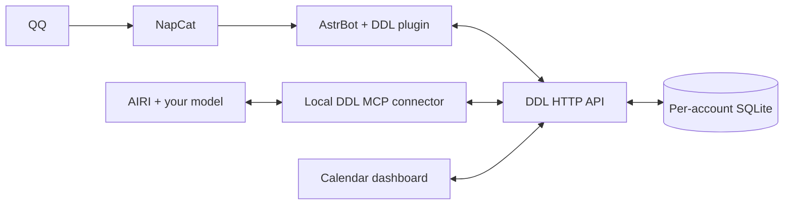

# Visualization-DDL

[简体中文](README.zh-CN.md) · MIT · Community project

A self-hosted calendar dashboard with income tracking, a focus timer, independent accounts, and two optional AI integrations. The calendar and SQLite backend run on Python's standard library. AIRI integration does not require AstrBot or NapCat.


## Three guides

1. [Deployment case study](docs/01-case-study.en.md): the working Ubuntu / DDL / AstrBot / NapCat architecture, storage, AI context and honest verification limits.
2. [DDL with AstrBot and QQ](docs/02-astrbot-qq.en.md): deploy DDL from scratch, then connect the included plugin to your independently installed AstrBot / NapCat.
3. [DDL with AIRI](docs/03-airi.en.md): deploy DDL independently and give AIRI native calendar tools through the included local stdio MCP connector.



## Try the dashboard

Requires Python 3.10+. It starts with an empty database.

```bash
git clone https://github.com/weyand138-netizen/Visualization-DDL.git
cd Visualization-DDL
python server.py
```

Open `http://127.0.0.1:8080`. For remote use, follow a deployment guide to configure a password and HTTPS. By default data is created in the ignored `data/` directory. Production data is never part of the source release.

## Features and boundaries

- Calendar/list views, optional event time, categories, completion, notes and income in integer RMB cents.
- Focus timer, account-local browser recovery, completed-session synchronization, daily targets and derived points.
- Light, dark and custom themes; Beijing time (`Asia/Shanghai`).
- Authorized QQ private `/日程` / `/ddl` commands, including up to three direct/quoted images via AstrBot.
- AIRI natural-language query/create/update/delete tools; no command prefix required.
- Per-account databases, transactional batches, request deduplication and stale-edit protection.

The dashboard's built-in AI preview is available when an AstrBot bridge is configured. The independent AIRI route uses AIRI chat for AI operations. Recurring events, proactive reminders and AIRI web/mobile-specific integrations are not included. The UI is currently Chinese; project and deployment documentation is bilingual.

## Development and validation

```bash
node --test tests/*.test.js
python -m unittest discover -s tests -p "test_*.py" -v
python -m pip install ./integrations/ddl_mcp
python -m unittest discover -s integrations/ddl_mcp/tests -v
python tools/privacy_check.py --history
```

See [validation results](docs/VALIDATION.md), [privacy policy for contributions](PRIVACY.md) and [contribution guide](CONTRIBUTING.md). Tests create disposable data. Only the optional connector installs third-party Python dependencies.

## AIRI ecosystem

This is an independent community project, not an official AIRI project. An English [ecosystem proposal](docs/AIRI-PROPOSAL.md) is provided for discussion with maintainers. Organization hosting requires their agreement and GitHub permissions; no affiliation is implied.
