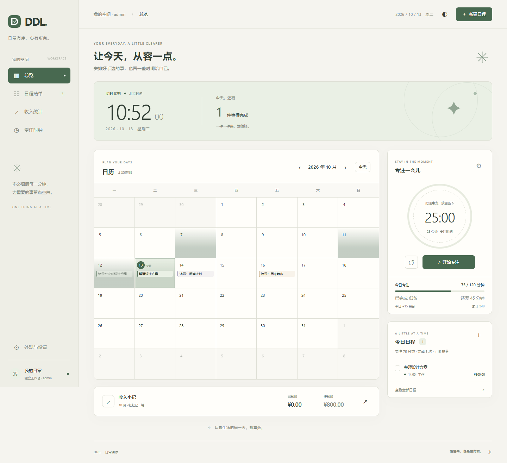

# Visualization-DDL

[English](README.md) · MIT · 社区项目

可自托管的日历日程工作台，包含关联收入、专注时钟、独立账户，以及两种可选 AI 接入。DDL 网页和 SQLite 后端仅使用 Python 标准库。AIRI 路线可独立部署，无需 AstrBot 或 NapCat。



## 三部分说明

1. [实操记录](docs/01-case-study.zh-CN.md)：Ubuntu、DDL、AstrBot、NapCat 的运行架构，数据存储、AI 上下文及实际验证范围。
2. [AstrBot / QQ 路线](docs/02-astrbot-qq.zh-CN.md)：从零部署 DDL，再将插件连接到自行按官方教程部署的 AstrBot、NapCat。
3. [AIRI 路线](docs/03-airi.zh-CN.md)：独立部署 DDL，安装本地 stdio MCP 连接器，让 AIRI 使用自己的模型管理日程。

两条路线共用 DDL 数据接口，任选其一，也可为同一账户同时使用。架构图见 [英文首页](README.md)。

## 本地试用

需要 Python 3.10+，首次启动为空数据库。

```bash
git clone https://github.com/weyand138-netizen/Visualization-DDL.git
cd Visualization-DDL
python server.py
```

打开 `http://127.0.0.1:8080`。远程部署请按指南设置密码和 HTTPS。默认数据写入已忽略的 `data/`，源码发布包不含任何使用者的数据。

## 功能与范围

- 日历与清单、日期和可选时间、分类、完成状态、备注和以整数分保存的人民币收入。
- 专注时钟、浏览器恢复、完成记录同步、每日目标与根据专注时长计算的积分。
- 明亮、暗色和自定义配色；时间按 `Asia/Shanghai` 处理。
- AstrBot 路线支持授权 QQ 私聊 `/日程`、`/ddl` 及最多三张当前消息或引用消息图片。
- AIRI 路线通过普通聊天调用查询、添加、修改、删除工具，无需指令前缀。
- 每个账户独立数据库，批量事务、请求去重和过期修改保护。

网页内置 AI 预览需配置 AstrBot 桥接；AIRI 独立路线在 AIRI 聊天中使用 AI，网页负责查看和手动编辑。暂不包含周期日程、主动提醒或 AIRI 网页版／手机版专用接入。网页界面目前为中文，项目与部署说明为中英双语。

## 检查与贡献

测试命令见 [英文首页](README.md#development-and-validation)，结果见 [验证记录](docs/VALIDATION.md)。提交前阅读 [隐私要求](PRIVACY.md) 和 [贡献说明](CONTRIBUTING.md)。测试使用临时数据库，仅可选 MCP 连接器需要额外 Python 依赖。

本项目目前是独立社区项目，尚未获得 AIRI 官方收录。已准备 [英文生态申请文案](docs/AIRI-PROPOSAL.md)，供后续与维护者讨论。
