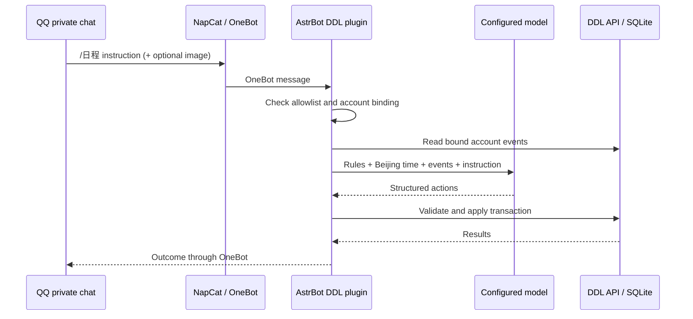

# Deployment case study

[中文](01-case-study.zh-CN.md) · [QQ guide](02-astrbot-qq.en.md) · [AIRI guide](03-airi.en.md)

The original deployment runs DDL, AstrBot and NapCat on Ubuntu. This publication is a fresh source-only export, not a copy of that machine, its databases or its Git history. The release does not change the original deployment. All published account names, addresses and screenshots are examples.

DDL is an independent web application and HTTP API. Only the AstrBot adapter is a plugin. NapCat transports QQ messages; the model runs through AstrBot's selected provider. The plugin accepts authorized private `/日程` or `/ddl` commands, resolves direct or quoted images (up to three), obtains the bound account's events, asks the model for a plan, and submits validated actions. Public HTTPS is provided by a reverse proxy; bot-token APIs remain on the private Docker network. The web AI preview uses the same AstrBot planning bridge. Without that bridge, the AI button is hidden.

## Storage and memory

| Location | Contents |
|---|---|
| `data/dashboard.sqlite3` | Administrator's calendar database |
| `data/users/<username>/dashboard.sqlite3` | Each additional account's separate database |
| `events` | ID, title, date, time, category, status, incomeCents, payment, notes, createdAt |
| `preferences` | JSON theme, focus duration and daily target |
| `focus` | Completed focus-session ID, seconds and date |
| `bot_requests` | Request ID, payload digest and saved result for retry deduplication |
| Browser local storage | Account-local preferences and unfinished focus recovery |
| AstrBot's own storage | Provider/platform settings and normal chat history; not exported here |

Passwords for additional users use PBKDF2-SHA256 hashes in private configuration. The administrator password comes from `DDL_PASSWORD`. Ordinary HTTP login selects the authenticated account. Bot access additionally requires an internal bearer token and an account header selected from the plugin's trusted QQ binding. Neither the model nor event notes may choose an arbitrary account.

The DDL planner's useful long-term context is the calendar it reads, not a second chat-memory database: current events + current Beijing time + fixed planning rules + this instruction/images. Normal AstrBot conversation history is managed separately by AstrBot. Focus statistics are derived from stored sessions. The MCP connector persists no additional conversation or memory store and exposes only events, the fixed account, time and versions to AIRI. AIRI's own chat memory remains AIRI's responsibility.

Both integrations can use the same DDL account to share its calendar, or different accounts for isolation. AIRI's model selects tools through normal conversation; the stdio connector translates tool calls into authenticated `/api/state` and `/api/events/batch` requests. No AstrBot installation or bot token is needed on that route.

## Evidence and limits

The pre-publication deployment had working Ubuntu services, account isolation, dashboard editing, focus synchronization and an AstrBot bridge. Its text and image model planning were exercised. Component checks covered message parsing, permission/binding handling, structured actions and HTTP persistence. We did **not** actively send a new real QQ message and observe its end-to-end delivery as part of release preparation. A healthy OneBot connection and parser tests alone do not prove that final step.

New connector tests use disposable databases, fictional users and the official MCP client. Desktop natural-language compatibility is recorded separately for each AIRI version in [VALIDATION.md](VALIDATION.md); source inspection or MCP SDK tests are not a desktop success claim. No production calendar, QQ binding, model credentials or conversation exports were used to create release assets.
