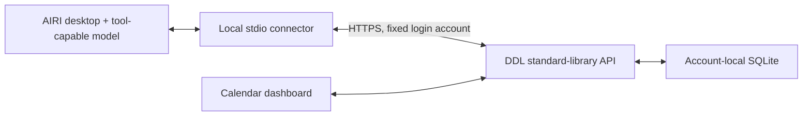

# Draft AIRI ecosystem proposal

**Prepared material only — not sent.** Visualization-DDL is an independent MIT community project. No official endorsement or organization membership is claimed.

## Suggested discussion title

Visualization-DDL: a self-hosted calendar and income dashboard with account-bound stdio MCP tools for AIRI

## Suggested introduction

Hello AIRI maintainers! I maintain [Visualization-DDL](https://github.com/weyand138-netizen/Visualization-DDL), a small self-hosted calendar dashboard. Its Python-standard-library backend stores each account separately in SQLite. An optional Python 3.11+ connector uses the official MCP SDK and gives AIRI four tools for calendar query/create/update/delete without changes to AIRI core or an AstrBot dependency.

The connector binds the account outside model arguments, uses HTTPS login, refuses redirects, and protects updates/deletes with full-snapshot versions plus backend optimistic concurrency checks. Writes reuse request IDs during network retries. It exposes only event data and necessary time/version context and maintains no extra chat history.

The repository includes bilingual installation guides, a separate AstrBot/QQ adapter, synthetic screenshots, CI and a candid [validation matrix](VALIDATION.md). Desktop/model combinations still awaiting end-to-end validation are explicitly marked. The demo workflow is: ask about this week, create a fictional deadline, mark it completed and paid, and delete it while observing the dashboard.

Would this be suitable for a community ecosystem listing or a small integration-doc contribution? If useful, I would also like to discuss eventual `proj-airi` hosting, subject to your maintenance expectations and permissions. I would welcome advice on placement and on the validation needed before an integration page is accepted.

## Architecture / demonstration

Use [synthetic calendar screenshot](images/dashboard-light.png), [AIRI guide](03-airi.en.md), [release notes](RELEASE-NOTES.md) and [validation results](VALIDATION.md) as accompanying material. A recorded desktop demonstration should be added only after an actual verified run; there is no fabricated video.

## Proposed maintenance commitment

The maintainer proposes to triage reproducible integration reports, preserve account isolation and privacy checks, test connector changes on Windows and Ubuntu, record SDK/AIRI compatibility changes, and keep deployments reproducible. This is a proposed community maintenance commitment, not an SLA or a promise that upstream has accepted responsibility.

## Submission and hosting path

1. Manually post to the official project's Discussions/community channel, after checking the currently available channel. Ask about an ecosystem listing or hosting; do not assume acceptance.
2. Follow maintainer feedback and the [AIRI contribution guide](https://github.com/moeru-ai/airi/blob/main/.github/CONTRIBUTING.md). Prefer an integration-document contribution; propose a narrowly scoped code PR only if changes to AIRI are actually required.
3. [`proj-airi`](https://github.com/proj-airi) is an organization for subprojects, not a Git branch. Transfer only after maintainer agreement and permission to create repositories in that organization, following [GitHub transfer rules](https://docs.github.com/en/repositories/creating-and-managing-repositories/transferring-a-repository). Remain labeled a community project until accepted.

中文：本文件仅准备英文介绍、架构、演示步骤、验证链接、维护承诺和申请文案，未向维护者发送消息，也未申请或执行仓库转移。公开发布不代表官方收录；应先讨论，再按反馈贡献文档，得到接受和建仓权限后才安排托管转移。
